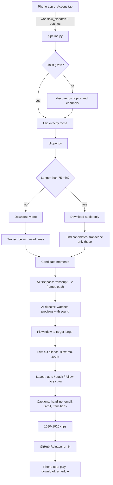

[Uploading README.md…]()
# Auto Clipper

Turns long videos and finished live streams into **vertical (1080×1920) YouTube Shorts**: it finds the funny moments, cuts them exactly, edits them, and writes the title, description and tags. It runs for free on **GitHub Actions** and is controlled from your phone with the companion app ([`clipper-app`](#the-companion-repo-clipper-app)).

> Only clip videos you own or have permission to use, and credit the creator. Auto-posting other people's footage can lead to copyright claims or strikes on your channel.

---

## Contents

1. [What it does](#what-it-does)
2. [How it works](#how-it-works)
3. [Repository structure](#repository-structure)
4. [Setup](#setup)
5. [Secrets and variables](#secrets-and-variables)
6. [Running it](#running-it)
7. [Settings reference](#settings-reference)
8. [Layouts and the facecam](#layouts-and-the-facecam)
9. [Clip length](#clip-length)
10. [Edits](#edits)
11. [AI providers](#ai-providers)
12. [Supported sources](#supported-sources)
13. [Outputs](#outputs)
14. [Live progress](#live-progress)
15. [config.json](#configjson)
16. [Troubleshooting](#troubleshooting)
17. [Limits and known issues](#limits-and-known-issues)
18. [Updating from an older version](#updating-from-an-older-version)
19. [Changelog](#changelog)
20. [The companion repo: clipper-app](#the-companion-repo-clipper-app)
21. [Security notes](#security-notes)
22. [Credits](#credits)

---

## What it does

| Area | Features |
|---|---|
| **Finding videos** | Give it video links, or topics + channels (searches inside each channel), or topics across YouTube. Skips videos already clipped. |
| **Finding moments** | Loudness spikes, YouTube chat-replay bursts, YouTube "most replayed", and funny-word matches in **Hindi, Hinglish and English** speech. |
| **AI picking** | An AI scores the best candidate moments from the transcript **and still frames**, with virality scores. |
| **AI director** | The AI watches a small preview (picture **and sound**) of each finalist and returns the **exact start and end**, the funniest second, edit cues, and a title, description and tags written for that exact clip. |
| **Exact length** | Every clip is as close as possible to the length you set (for example **58 s**), never more than 59 s. |
| **Layouts** | **Automatic** per clip: facecam on top with gameplay below, a followed face for one person, or the whole frame on a blurred background for crowds. Always 1080×1920. |
| **Edits** | Word-by-word captions at the bottom with highlighted words, emoji pop-ups, an opening headline, silence cutting, punch-in zoom with slow motion, optional stock B-roll and transitions. |
| **Long streams** | Videos longer than 75 min use a fast mode: audio only, shortlist, then download only the chosen sections. Tested up to 4+ hours. |
| **Sources** | YouTube, Twitch VODs, Kick VODs, direct video-file links (Drive, Dropbox…). |
| **Hands-off** | Runs from your phone, shows live progress, saves clips to a release, schedules uploads to YouTube, and learns from your video stats. |

---

## How it works



In words:

1. **`pipeline.py`** reads `config.json`, applies the settings sent from the app, and decides which videos to clip (explicit links, or `discover.py` searching your topics and channels).
2. **`clipper.py`** does the work per video (steps below).
3. The workflow publishes the clips as a **GitHub Release** named `run-<number>`. The app reads that release.

### Steps inside `clipper.py`

1. **Check** the video (live? too long?) and download it. Short videos are downloaded whole; long ones are handled audio-first.
2. **Transcribe** with `faster-whisper` (word timestamps). Long mode transcribes only the shortlisted moments.
3. **Score** every second: loudness, chat spikes, "most replayed", and funny words.
4. **Candidates**: the best windows (about 3× the clips you asked for).
5. **AI first pass** (`ai_pick.py`): the 12 most promising candidates, with transcript and 2 frames each, get virality scores.
6. **AI director** (`director.py`): the top finalists (clips + 3) get a low-quality preview with sound. The AI returns exact cuts, the funny peak, zoom and slow-motion cues, emphasis words, emoji, and title/description/tags.
7. **Fit** each clip to your target length (`edit.py` plans the edits first so the final length is right).
8. **Edit** (silence cuts, slow motion), choose the **layout**, then render captions, headline, emoji, optional B-roll and transitions.

---

## Repository structure

```
auto-clipper/
├── .github/
│   └── workflows/
│       └── clip.yml        # the workflow (manual run, settings as inputs)
├── clipper.py              # main engine: download, transcribe, score, layouts, rendering
├── pipeline.py             # entry point: chooses videos, runs clipper.py, builds the release folder
├── discover.py             # finds videos from topics, channels and searches (yt-dlp)
├── ai_pick.py              # AI first pass; Gemini and OpenRouter calls; learns from performance.json
├── director.py             # AI director: previews, exact cuts, titles, descriptions, tags
├── edit.py                 # silence cutting, slow motion, zoom, timeline mapping, emoji images
├── broll.py                # stock footage downloads (Pixabay, or Pexels if you already have a key)
├── progress.py             # live progress for the phone app (commit statuses)
├── config.json             # default settings and search sources
├── requirements.txt        # Python packages
├── processed.json          # created automatically: videos already clipped
└── README.md
```

Notes:

- **Only `.github/workflows/clip.yml` is used.** If you also have a `clip.yml` at the top level, delete it.
- `processed.json` is created and committed by the workflow. You don't write it.
- The `output/`, `release/` and `cookies.txt` files exist only inside a run. They are not committed.

---

## Setup

**1. Create the repo** (make it **private**, because releases follow the repo's visibility and your clips would otherwise be public).

**2. Upload the files** from the structure above. Create the workflow at exactly `.github/workflows/clip.yml` (use *Add file → Create new file* and type that path).

**3. Allow the workflow to save things.** *Settings → Actions → General → Workflow permissions → Read and write permissions → Save.*

**4. Add secrets** (next section). At minimum: `YT_COOKIES`. For AI: `GEMINI_API_KEY` or `OPENROUTER_API_KEY`.

**5. Edit `config.json`** (channels, topics, language) or just use links from the app.

**6. Run it** from the **Actions** tab, or from the phone app ([clipper-app](#the-companion-repo-clipper-app)).

---

## Secrets and variables

Add secrets under *Settings → Secrets and variables → Actions → Secrets*, variables under the **Variables** tab. Names must match exactly.

| Name | Type | Required | What it is for |
|---|---|---|---|
| `YT_COOKIES` | Secret | **Yes** for YouTube | Your YouTube cookies (Netscape `cookies.txt`). Without them YouTube blocks GitHub's servers ("Sign in to confirm you're not a bot"). Use a spare Google account. |
| `GEMINI_API_KEY` | Secret | Recommended | Free key from Google AI Studio. Turns on AI picking and the director. |
| `OPENROUTER_API_KEY` | Secret | Optional | Used if Gemini is missing or fails. Needs a video-capable model. Paid per use (small). |
| `PIXABAY_API_KEY` | Secret | Optional | Free key. Stock B-roll. |
| `PEXELS_API_KEY` | Secret | Optional | Only if you already have a key (Pexels paused new keys). |
| `GEMINI_MODEL` | Variable | Optional | Force one Gemini model name. |
| `OPENROUTER_MODEL` | Variable | Optional | Force one OpenRouter model name (must accept video). |
| `PERF_URL` | Variable | Optional | Link to your `performance.json` so the AI learns from your results. Set it to `https://raw.githubusercontent.com/<you>/clipper-app/main/performance.json`. |

`GITHUB_TOKEN` is provided by Actions automatically (used for the release and live progress).

### Making the cookies file

1. Open a **private window** in your browser and sign in to a **spare** Google account.
2. In that tab open `https://www.youtube.com/robots.txt`.
3. Export with the "Get cookies.txt LOCALLY" extension, then **close the private window right away** (YouTube rotates cookies if you keep browsing).
4. Paste the whole file into the `YT_COOKIES` secret. Never paste it anywhere else, never commit it.

Refresh it whenever downloads start failing with bot-check errors.

---

## Running it

### From the phone app (recommended)

Open Clip Desk, paste links or topics, adjust settings, tap **Start clipping**. See [clipper-app](#the-companion-repo-clipper-app).

### From GitHub

*Actions → Auto clip pipeline → Run workflow*, fill the inputs ([reference](#settings-reference)), run. Results are in the run's **Release** (*Code → Releases → run-N*).

### On your own computer

```bash
sudo apt install ffmpeg fonts-noto-core     # or install ffmpeg + a Noto font
pip install -r requirements.txt
export GEMINI_API_KEY=...                   # optional
python clipper.py "https://youtu.be/VIDEO_ID" --num 5 --length 58 --language hi --cookies cookies.txt
```

Or run the whole pipeline (discovery, release folder):

```bash
RUN_URLS="https://youtu.be/VIDEO_ID" RUN_LENGTH=58 python pipeline.py
```

---

## Settings reference

Each is a workflow input (and a setting in the app). Defaults below are the workflow defaults.

| Input | Default | Choices | Meaning |
|---|---|---|---|
| `urls` | empty | links | Video links (space or comma separated). Empty means search. Each is clipped even if clipped before. |
| `channels` | empty | links, or `none` | Channels to search in. `none` searches all of YouTube. |
| `topics` | empty | comma list | Topics to look for (English or Hindi). |
| `videos` | `1` | 1–5 | How many videos to clip (search mode). |
| `num` | `5` | 1–15 | Clips per video. |
| `length` | `40` | 10–90 | Clip length in seconds. Use **58** for Shorts. |
| `length_mode` | `target` | `target`, `ai` | `target`: as close to `length` as possible. `ai`: the AI decides, up to `length`. |
| `language` | `hi` | `hi`, `en`, `auto` | Speech language for transcription. |
| `model` | `small` | `tiny`, `base`, `small` | Speech-to-text quality. Slower and better to the right. |
| `framing` | `auto` | `auto`, `stack`, `blur`, `face`, `center` | Vertical layout. See [Layouts](#layouts-and-the-facecam). |
| `facecam` | `auto` | `auto`, `tl`, `tr`, `bl`, `br`, `none` | Where the facecam is. |
| `captions` | `karaoke` | `karaoke`, `classic`, `off` | Word-by-word, plain lines, or none. |
| `hook` | `auto` | `auto`, `off` | Headline in the first 3 seconds. |
| `height` | `1080` | `720`, `1080`, `1440` | Source quality to download. Output is always 1080×1920. |
| `ai` | `on` | `on`, `off` | AI moment picking and virality scores. |
| `director` | `on` | `on`, `off` | AI director (previews, exact cuts, titles). Needs `ai` on. |
| `punch` | `on` | `on`, `off` | Zoom and slow motion on the funny moment. |
| `cut_silence` | `on` | `on`, `off` | Remove silent gaps. |
| `emoji` | `on` | `on`, `off` | Emoji pop-ups and highlighted words. |
| `broll` | `off` | `off`, `auto` | Stock footage cutaways (needs AI and a Pixabay key). |
| `transitions` | `off` | `off`, `fade`, `flash`, `slide`, `wipe`, `zoom`, `circle`, `mix` | Fades at the ends plus the style used for B-roll cutaways. |

Extra options available only in `config.json` or as `clipper.py` flags: `caption_margin` (default 230), `facecam_size` (default 0.26), `--long-minutes` (75), `--max-minutes` (720).

---

## Layouts and the facecam

All layouts produce **1080×1920**. With `framing: auto` the clipper decides **per clip**:

| Situation | Layout |
|---|---|
| A **facecam overlay** is found (or you set its corner) | **Stack**: facecam on top (1080×640), gameplay below (1080×1280), headline on the line between. |
| **One person** in view for at least 60% of the clip | **Follow the face**: a vertical crop that glides after the same person. |
| **Several people** in view for at least 30% of the clip, or no clear single person | **Blur**: the whole frame centered over a blurred copy of itself. |

### How the facecam is found

- A face detector (**YuNet**, downloaded on first use; falls back to OpenCV Haar, which is less accurate) looks at **12 frames spread over the whole video**.
- The facecam is the face that sits in the **same place** in at least 30% of those frames (within about 6% × 8% of the frame). Corner positions get a bonus. **Game characters move around, so they never qualify.**
- Only faces near that spot are tracked inside each clip, so a game character can no longer be mistaken for the streamer.
- The gameplay crop moves sideways if the facecam is in the way.
- `facecam_check.jpg` (in the release as `<videoid>_facecam_check.jpg`) shows what was detected, with a green box.

If detection picks wrongly, set the corner by hand: `facecam: tl | tr | bl | br`, or `none` when there is no facecam.

### Other layouts

- `stack` needs a facecam. Without one it falls back to blur.
- `face` follows a moving person. A small corner overlay switches it to stack automatically.
- `blur` always works. `center` is a plain center crop.

The log prints the decision, for example `automatic layout: blur (several people are in view (80% of the clip))`.

---

## Clip length

- **`length_mode: target`** (default): the AI finds the funny moment, then each clip grows around it until its **final, edited length** matches `length` (for example 58.0 s). Cutting silence and slow motion change a clip's length, so the clipper plans the edits first and fits the window. Never more than **59 s**. If the video ends too soon, the clip can be shorter.
- **`length_mode: ai`**: the director chooses the length (8–55 s), up to `length`.

---

## Edits

| Edit | Details |
|---|---|
| **Captions** | Word-by-word at the bottom (above YouTube's own title area). The spoken word lights up. **Highlighted words** (picked by the AI, or the loudest words) get bigger and red-orange. Font: Noto Sans (Devanagari works). |
| **Headline** | English headline in the first 3 seconds, from the AI (or the source title). On the seam between face and gameplay in stack layout. |
| **Emoji** | Up to 3 emoji pop up above the captions at the right moments (Twemoji images). |
| **Cut silence** | Removes gaps of at least 0.9 s with no speech **and** no loud sound. Keeps 0.25 s on each side. Never removes more than 30% of a clip. Gaps with game sounds stay. |
| **Zoom + slow motion** | Punch-in zoom (+18%) and a half-speed replay of the key 1–2 seconds, at the AI's cue or the loudest moment. |
| **B-roll** | Up to 2 short stock cutaways per clip (Pixabay). Off by default. |
| **Transitions** | Fade in/out at the clip ends; B-roll cutaways come in with `fade`, `flash`, `slide`, `wipe`, `zoom`, `circle`, or a `mix`. |

---

## AI providers

The AI is optional. Without any key the clipper still works using sound, chat and keyword scores (no director, no AI titles).

1. **Gemini** (`GEMINI_API_KEY`) is tried first. Default model order: `gemini-3.5-flash`, `gemini-3.5-flash-lite`, `gemini-flash-latest`, `gemini-flash-lite-latest`, `gemini-3.1-flash-lite`, `gemini-2.5-flash`. Set `GEMINI_MODEL` to force one.
2. **OpenRouter** (`OPENROUTER_API_KEY`) is used if Gemini is missing or fails. It must be a model that accepts **video input**. Default: `google/gemini-3.5-flash`, then `google/gemini-3.5-flash-lite`. Set `OPENROUTER_MODEL` to force one.

Every failure prints its real reason in the log (`over its limit`, `not found`, `timed out`, `key rejected`, `out of credits`). The first pass judges the 12 best candidates; the director previews the top clips + 3, three per request.

**What the AI sees:** the transcript with times, 2 frames per candidate, and for finalists a small preview video **with sound**. It does not see the full-quality video.

### Learning from your results

`clipper-app` records views and likes of the clips you upload into `performance.json`. Before picking, the AI is shown your best and weakest clips so far (needs 4+ videos that are at least a day old). Set `PERF_URL` to your own file.

---

## Supported sources

| Source | Notes |
|---|---|
| YouTube videos and finished live streams | Needs `YT_COOKIES`. Chat replay and "most replayed" signals work only here. |
| Twitch VODs | Live (ongoing) streams are refused. |
| Kick VODs | Behind a bot check; `curl-cffi` is installed for this. May still be blocked from GitHub's servers. |
| Direct file links | Any video URL yt-dlp can read, e.g. a shared Drive or Dropbox link. |

Live streams must have **ended**. Uploading a file from your phone is not supported; use a Drive/Dropbox link instead.

---

## Outputs

Each run publishes a **Release** named `run-<number>` containing:

- `<videoid>_clip_01.mp4`, `..._clip_02.mp4`, and so on: 1080×1920 H.264/AAC, ready for Shorts.
- `index.json`: the details of every clip (also in the release notes, which is what the app reads).
- `<videoid>_facecam_check.jpg`: what the facecam detector saw.

The **10 newest** releases are kept; older ones are deleted automatically. A 3-day backup is also stored as a workflow artifact.

### Clip details (`index.json`)

`file`, `source`, `source_title`, `channel`, `source_duration`, `start`, `end`, `length`, `score`, `virality`, `virality_detail`, `reason`, `visual`, `hook`, `layout` (`stack`, `face`, `blur`, `center`), `game`, `ai_titles` (up to 5), `ai_title`, `ai_description`, `ai_tags`, `edits` (`cuts`, `slowmo`, `zoom`, `emoji`, `highlighted`), `broll`, `topics`.

---

## Live progress

The workflow has `statuses: write` permission. While a run is going, `progress.py` posts a commit status named `progress-<run id>` whose description is `<percent>|<step>`, at most one update per 4 seconds. The phone app reads it and shows a bar and the current step ("Transcribing 40%", "Editing clip 2 of 5"). Without the permission, runs still work, just without the bar.

---

## config.json

Defaults used when the app does not send a value (and for search mode).

```json
{
  "channels": ["https://www.youtube.com/@yourchannel"],
  "topics": ["GTA", "glitch", "funny"],
  "queries": [],
  "min_duration_minutes": 15,
  "max_duration_minutes": 120,
  "max_age_days": 90,
  "min_views": 0,
  "results_per_source": 10,
  "max_videos_per_run": 1,
  "clips_per_video": 5,
  "clip_length_seconds": 40,
  "language": "hi",
  "whisper_model": "small",
  "max_height": 1080
}
```

| Key | Meaning |
|---|---|
| `channels` | Channels to search in (links; the `/videos` or `/streams` tab is not needed). |
| `topics` | Searched **inside each channel**. If `channels` is empty, `queries` is used for a YouTube-wide search. |
| `min_duration_minutes`, `max_duration_minutes` | Length range of videos considered in search mode. Raise `max_duration_minutes` to include long streams. |
| `max_age_days`, `min_views` | Freshness and popularity filters. |
| `results_per_source` | How many search results per source. |
| `max_videos_per_run` | Videos clipped per run in search mode. |

Keep keys unique. A duplicated key silently uses the last value.

---

## Troubleshooting

| Symptom in the log | Cause and fix |
|---|---|
| `Sign in to confirm you're not a bot`, `HTTP Error 403`, `Video unavailable` on every video | YouTube is blocking GitHub's servers. Refresh `YT_COOKIES` (see above). If only one video says unavailable, check that it plays in a browser. |
| `ERROR: this video is still live or has not started` | Wait until the stream ends and its replay is processed. |
| `... is 4h 32m long; the limit is 240 min` | Old version. Update; the limit is now 12 hours with long-video mode. |
| `ffmpeg exited with code 8` when downloading sections | Fixed: sections are now cut straight from the stream URLs, with yt-dlp as the fallback. Update `clipper.py`. |
| Kick: `extractor is attempting impersonation` | Needs `curl-cffi`. Use the current `requirements.txt` (`yt-dlp[default,curl-cffi]`). Kick may still block data-center servers. |
| `AI picking: ... over its limit` or `not usable (404)` | Free quota or a retired model. Read the printed reason; set `GEMINI_MODEL`, or add `OPENROUTER_API_KEY`. |
| `no GEMINI_API_KEY or OPENROUTER_API_KEY secret` | Add the secret **in this repo**. |
| `no facecam found ... using the blur layout` | There is no fixed facecam, or detection missed it. Look at `facecam_check.jpg`; set `facecam` to a corner by hand. |
| `face detector: Haar (less accurate)` | The YuNet model could not be downloaded. Re-run, or set the corner by hand. |
| Run is green but there is no `.mp4` | Old version counted that as success. The current one fails the run and prints `WHY CLIPS WERE NOT MADE`. |
| `Save processed list` fails with `rejected (fetch first)` | Fixed: it now pulls and retries, and never fails the run. |
| Clips are not 58 s | Set `length_mode: target`. Very short sources, or moments near the end of the video, can give shorter clips. |
| Captions show empty boxes | The Noto font is missing. The workflow installs `fonts-noto-core`; install it when running locally. |
| Progress bar missing in the app | The workflow needs `permissions: statuses: write` (present in the current `clip.yml`). |

---

## Limits and known issues

- **GitHub Actions minutes:** public repos are free and unlimited; private repos get 2,000 free minutes a month. A run takes roughly 15–60 minutes depending on length and the speech model.
- **Run time limit:** 300 minutes per run.
- **Clips are kept for the 10 newest runs**, then deleted.
- **Face detection** was built to avoid game characters but is the weakest part. Set the facecam corner by hand when in doubt. It cannot tell which of several people is speaking.
- **The facecam on top** is cropped from a small overlay, so it can look soft when scaled up to 1080 wide.
- **Slow motion** also slows the sound.
- **The AI's idea of "funny"** is subjective. Review clips before posting.
- Phone-file uploads, Instagram and TikTok posting, and a clip editor are **not included**.

---

## Updating from an older version

Replace these files in `auto-clipper`:

`clipper.py`, `ai_pick.py`, `pipeline.py`, `edit.py`, `director.py`, `progress.py`, `broll.py`, `discover.py`, `requirements.txt`, `.github/workflows/clip.yml`, and the new `README.md`.

Then:

1. Add new secrets if you want them: `GEMINI_API_KEY` and/or `OPENROUTER_API_KEY`, optional `PIXABAY_API_KEY`.
2. Update `clipper-app/index.html` (the phone app). The app **remembers old settings** in your browser, so open *Clip settings* once and set *Vertical layout* to *Automatic* and *Clip length* to your seconds.
3. Keep `config.json` as it is; new keys are optional.

---

## Changelog

**Latest**
- **Exact length:** `length_mode: target` makes clips as close to your seconds as possible (up to 59) after silence cuts and slow motion.
- **Automatic layout:** facecam gives stack, one person gives follow the face, a crowd or unclear scene gives the whole frame on blur.
- **Follow the face works without a fixed facecam** by tracking one person continuously.
- **Facecam finder:** locates the real facecam over 12 frames, ignores moving game characters; manual corners; debug picture.
- **OpenRouter** as a fallback AI provider (images and video).
- **Safer AI parsing:** accepts a bare list answer; every AI error prints its reason; models are tried in order.

**Earlier**
- **AI director:** exact cuts from previews with sound; titles, descriptions, tags and game name per clip.
- **Edits:** silence cutting, slow motion with zoom, highlighted words, emoji pop-ups, headline, captions at the bottom.
- **Long streams:** audio-first mode; sections cut straight from stream URLs.
- **Sources:** Twitch, Kick, direct links.
- **Live progress** and **transitions** (fade, flash, slide, wipe, zoom, circle, mix).
- **Reliability:** failed runs show the reason; the `processed.json` push retries; clips of red runs can still be opened.

**First version**
- Download, transcribe, score by loudness, cut vertical clips with captions, run from GitHub Actions, scheduled uploads via `clipper-app`.

---

## The companion repo: clipper-app

A second, small **public** repo hosts the phone app and the upload scheduler. See its own README. In short:

- `index.html`: **Clip Desk**, a phone web app (GitHub Pages). Start runs, watch progress, play and download clips, edit title, description and tags, schedule YouTube uploads.
- `publish.py` and its workflow: upload queued clips to YouTube every 15 minutes, scheduled to the exact time.
- `stats.py` and `performance.json`: collect views and likes for the learning loop.

The two repos talk through the GitHub API with a fine-grained access key stored only in your phone's browser.

---

## Security notes

- Keep `auto-clipper` **private**. Clips are release assets and follow the repo's visibility.
- Never paste cookies, API keys, refresh tokens or screenshots of them into chats or commits. If one leaks, rotate it: sign out of the Google sessions, create new keys, and update the secrets.
- Use a **spare Google account** for cookies and for the YouTube channel login.
- Use fine-grained GitHub keys limited to your two repos, and note their expiry date.

---

## Credits

Built on **yt-dlp**, **FFmpeg**, **faster-whisper**, **OpenCV** (the YuNet face detector from the OpenCV Zoo), **NumPy**, **Requests**, and AI from **Google Gemini** or **OpenRouter**. Emoji images are **Twemoji** (graphics licensed CC-BY 4.0). Stock footage comes from **Pixabay** (and Pexels if you have a key).
